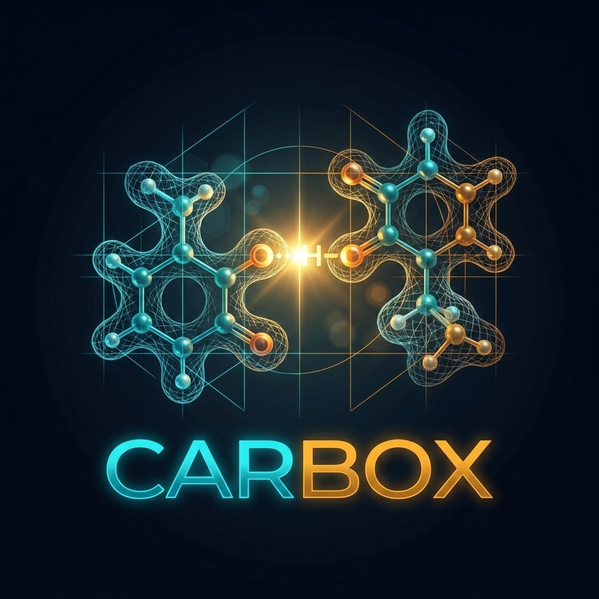

# Project Carbox — Official Documentation Repository

<p align="center">
  
</p>

<p align="center">
  <strong>Structural Identification of Anomalous Carboxyl Protonation States, Low-Barrier Hydrogen Bonds, and Microenvironment Dielectric Shielding</strong>
</p>

<p align="center">
  <a href="https://project-carbox.readthedocs.io/en/latest/"></a>
  <a href="https://project-carbox.readthedocs.io/en/latest/"></a>
  <a href="https://project-carbox.github.io/"></a>
  <a href="mailto:suleyman.hacizade1@gmail.com?subject=Private%20Data%20%26%20Repository%20Access%20Request%20-%20Project%20Carbox"></a>
</p>

---

### Authors & Academic Affiliations
* **Suleiman M Hajizadeh** — *Institute of Molecular Biology, Ministry of Science and Education of the Republic of Azerbaijan & Western Caspian University, Baku, Azerbaijan*
* **Garib N Murshudov** — *MRC Laboratory of Molecular Biology (LMB), Cambridge Biomedical Campus, Cambridge, United Kingdom*

---

## 📖 Overview

This repository hosts the **official public Sphinx documentation source** for **Project Carbox**, deployed live to **Read the Docs**:

👉 🌐 **[https://project-carbox.readthedocs.io/en/latest/](https://project-carbox.readthedocs.io/en/latest/)**

> [!NOTE]
> **Data Governance & Separation of Concerns:**  
> Core computational pipeline source codes (`carbox`), raw 7,230-structure PDB screening matrices, and electron density correlation tables are maintained in the private core engine (`project-carbox/carbox`). To request collaborative access, contact **[suleyman.hacizade1@gmail.com](mailto:suleyman.hacizade1@gmail.com)**.

---

## 📚 What is Covered in this Documentation?

1. **Trilingual Documentation (100% Parity):**
   - 🇬🇧 **English (`docs/en/`):** Algorithmic theory, command-line interfaces, Python API, and REFMAC5/Servalcat restraints.
   - 🇦🇿 **Azərbaycan dili (`docs/az/`):** Bütün kristalloqrafik metodologiyanın, düsturların və tətbiqlərin ana dilimizdə tam elmi izahı.
   - 🇮🇱 **עברית (`docs/he/`):** Full right-to-left Hebrew translation for international research parity.
2. **Scientific Memoranda & Manuals:**
   - `CARBOX_MASTER_MANUAL.md` / `CARBOX_MASTER_MANUAL.pdf`: Master scientific monograph and usage manual.
   - `CARBOX_CRYSTALLOGRAPHIC_VALIDATION_MEMORANDUM.md`: Prof. Garib N Murshudov's 4-stage validation gate theory.
3. **Crystallographic Refinement Restraints:**
   - Automated generation of geometric, distance, and protonation restraints for **REFMAC5** and **Servalcat**.

---

## 🛠️ Local Build Instructions

```bash
# Install Sphinx dependencies
pip install -r docs/requirements.txt

# Build HTML documentation
sphinx-build -b html docs docs/_build/html
```

---

## 📜 License

Mozilla Public License 2.0 (MPL-2.0). See [LICENSE](LICENSE) for details.
